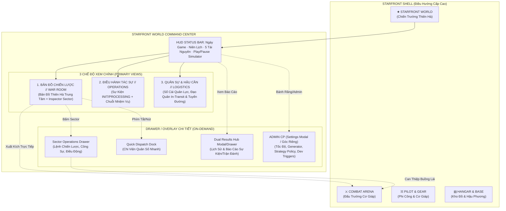

# STARFRONT WORLD — Phase 6.16: UI/UX Audit & Redesign Blueprint
## Báo Cáo Đánh Giá Hiện Trạng & Thiết Kế Kiến Trúc Trực Quan Toàn Diện

> **Mã văn bản**: `STARFRONT-WORLD-6.16-UIUX-BLUEPRINT`  
> **Giai đoạn**: Phase 6.16 — UI/UX Audit & Redesign Blueprint  
> **Trạng thái**: Đã phê duyệt đặc tả thiết kế (Design Blueprint Confirmed)  
> **Nguyên tắc kỹ thuật**: **Chỉ phân tích & lập kế hoạch. Không chỉnh sửa code logic, không can thiệp gameplay/công thức/vòng đời/storage.**

---

## 1. Đánh Giá Hiện Trạng UI/UX & Các Vấn Đề Cụ Thể

### 1.1. Hiện trạng Tổng thể
Hệ thống **STARFRONT WORLD** sau các Phase 6.1 đến 6.15 đã sở hữu nền tảng dữ liệu và động cơ cực kỳ vững chắc:
- Đồ thị 8 Sector và 12 tuyến siêu không gian với các trạng thái (`open`, `hazardous`, `blocked`, `offline`).
- Sổ cái tài nguyên 5 loại có bảo toàn (`industrialMaterials`, `energy`, `logisticsSupplies`, `tacticalData`, `food`).
- Sổ cái quân sự bảo toàn quân số (`deployed`, `reserves`, `woundedOrRepair`, `retreating`, `casualties`).
- Máy trạng thái 5 giai đoạn (`normal`, `threatened`, `under_siege`, `lost`, `recovery`) và độc lập với chủ quyền (`sovereignty`).
- Động cơ thời gian thực với niên lịch 4 buổi (`Sáng`, `Chiều`, `Tối`, `Đêm`), bộ sinh sự kiện 3 tier (`small`, `medium`, `large`), và chính sách chọn chiến lược 3 cấp (`System Auto` $\rightarrow$ `Default Fallback` $\rightarrow$ `Player Choice`).

Tuy nhiên, qua kiểm tra chuyên sâu các component giao diện hiện tại:
- `components/game/starfront-shell.tsx`
- `components/game/world/operations-center.tsx`
- `components/game/world/world-map.tsx`
- `components/game/world/events-missions-board.tsx`
- `components/game/world/dual-results-hub.tsx`
- `components/game/world/world-fullscreen-overlay.tsx`
- Khối ADMIN CP trong `operations-center.tsx`

### 1.2. Các Vấn Đề UX/UI Cụ Thể Được Phát Hiện

| Khu vực | Hiện trạng | Vấn đề UX/UI cụ thể | Mức độ |
|---|---|---|---|
| **Điều hướng Shell** | Menu sidebar có tới 10 mục chính (`home`, `world`, `character-gear`, `gallery`, `battlefield`, `missions`, `mission-logs`, `shop`, `hangar`, nhóm `Căn Cứ & Hạm Đội`). | • `world` nằm ở vị trí thứ 2 nhưng bị kẹp giữa các mục RPG cá nhân.<br>• Có sự trùng lặp nhận thức nghiêm trọng giữa `missions` (RPG campaign cũ 12 nhiệm vụ) và `world / events` (Chiến trường thiên hà động). Người chơi mới dễ nhầm lẫn.<br>• Phân hệ chiến lược cấp thiên hà bị phân mảnh với hạm đội/căn cứ. | **P0** |
| **Header Toàn Cục WORLD** | `operations-center.tsx` có một header rất cao, gồm: Tiêu đề + Chấm ping + Status Pill + 4 nút tác vụ (`Bản Đồ Fullscreen`, `Tiến 1 Ngày`, `Điều Quân Nhanh`, `Lưu`) + Thanh 5 tài nguyên + Toast thông báo. | • Header chiếm từ 180px–220px chiều cao màn hình trước khi render nội dung chính.<br>• Thanh tài nguyên dạng bảng lưới 5 cột trông giống ERP quản trị doanh nghiệp hơn là buồng chỉ huy Sci-Fi.<br>• Cụm nút tác vụ đặt cạnh nhau thiếu phân cấp thị giác (nút tàn phá thời gian `+1 Ngày` đặt ngang hàng với nút mở modal xem bản đồ). | **P1** |
| **Bản đồ Thiên hà (Galaxy Map)** | `world-map.tsx` có đồ thị SVG rất trực quan và inspector mạnh mẽ, nhưng bị nhét trong một tab con `map` với chiều cao cố định `640px` (nếu không bật fullscreen). | • Bản đồ — vốn là trái tim của một game chiến lược — bị đối xử như một tab bình thường ngang hàng với `sectors` hay `admin`.<br>• Khi ở tab `overview` hay `sectors`, người chơi không nhìn thấy bản đồ, mất đi sự kết nối không gian.<br>• Tab `sectors` liệt kê 8 thẻ sector lặp lại gần như 90% thông tin đã có trên Inspector của bản đồ SVG. | **P0** |
| **Sự kiện & Quyết định (Events & Missions)** | `events-missions-board.tsx` có nội dung phong phú nhưng mật độ thông tin quá dày. Mỗi thẻ sự kiện INIT chứa cả badge urgency, phân loại, đếm ngược, mô tả, lý do auto thất bại, cảnh báo tự động khóa, danh sách 3 phương án với điểm số và phân tích. | • Cuộn chuột quá dài nếu có từ 3 sự kiện trở lên.<br>• Người chơi bị ngợp bởi các con số chấm điểm và cảnh báo lặp đi lặp lại.<br>• Thiếu luồng "Tóm tắt & Phê chuẩn nhanh" (Quick triage). | **P1** |
| **Quân sự & Tuyến đường** | Tab `military` trình bày dạng danh sách khối dọc: Sổ cái quân sự $\rightarrow$ Đạo quân in-transit $\rightarrow$ Lưới 12 tuyến siêu không gian. | • Dữ liệu tuyến đường hiển thị dạng bảng chữ đơn điệu (`sol_command_hq <-> centauri_mining`), trong khi trên bản đồ SVG các tuyến đường này đã được vẽ trực quan.<br>• Thiếu tính tương tác: Không thể bấm vào tuyến đường để xem chi tiết hoặc điều quân. | **P2** |
| **Dual Results Hub** | `dual-results-hub.tsx` hoạt động tốt nhưng bị tách thành tab riêng biệt trên thanh điều hướng chính của WORLD. | • Khi sự kiện hoàn tất, kết quả xuất hiện ở đây nhưng người chơi ít khi chủ động chuyển tab `results` để đọc trừ khi có badge đỏ.<br>• Chưa có drawer hoặc thông báo kết quả trượt (flyout briefing) khi kết thúc tick. | **P2** |
| **ADMIN CP** | ADMIN CP nằm thành một tab ngang hàng (`admin`) với các tab tác chiến thường ngày. | • Vi phạm nguyên tắc nhập vai (Immersion): Các công cụ dev triggers, force spawn, đổi tốc độ simulator, reset world nằm ngay cạnh bản đồ tác chiến.<br>• Người chơi thông thường dễ vô tình bấm nhầm các nút can thiệp dev hoặc reset. | **P0** |

---

## 2. Đề Xuất Cấu Trúc Menu Chính & Vị Trí WORLD

### 2.1. Phân Tích Vị Trí Cấp Cao Nhất Của WORLD
- **STARFRONT** là tựa game kết hợp hai lớp trải nghiệm:
  1. **Lớp Chỉ Huy Chiến Lược Vĩ Mô (Macro Strategic Command)**: Vận mệnh thiên hà, 8 sector, kiểm soát lãnh thổ, tài nguyên, đạo quân, sự kiện thời gian thực (**WORLD**).
  2. **Lớp Buồng Lái Nhập Vai Chiến Thuật (Tactical Mecha RPG)**: Cá nhân hóa phi công, 3 lớp cơ giáp (`Vanguard`, `Falcon`, `Aegis`), trang bị, vũ khí, kỹ năng, và đấu trường theo lượt 2D.
- **Kết luận kiến trúc**: **WORLD phải là tâm điểm chiến lược của toàn bộ trải nghiệm.**
  - Đưa `WORLD` lên vị trí điều hướng chiến lược trung tâm, tách bạch rõ ràng với các phân khu "Hậu Phương / Xưởng Cơ Giáp" (RPG Arsenal & Hangar) và "Buồng Lái / Đấu Trường" (Tactical Arena).

### 2.2. Phương Án Tổ Chức Menu Shell Được Khuyến Nghị: Mô Hình 3 Tầng Chỉ Huy (Command Tier Architecture)

Thay vì danh sách phẳng 10 mục rời rạc, menu chính được tái cấu trúc thành 3 khối phân định theo mục đích:

```
┌────────────────────────────────────────────────────────┐
│  STARFRONT COMMAND CONSOLE (SHELL NAVIGATION)           │
├────────────────────────────────────────────────────────┤
│  [KHỐI 1: TỔNG HÀNH DINH CHIẾN LƯỢC // STRATEGIC HUB]  │
│  ★ CHIẾN TRƯỜNG THIÊN HÀ (STARFRONT WORLD)  [LIVE]     │
│    └─ Trung tâm điều hành, bản đồ, sector & sự kiện    │
│  ○ TỔNG QUAN TÁC CHIẾN (COMMAND DASHBOARD)             │
│                                                        │
│  [KHỐI 2: BUỒNG LÁI & TÁC CHIẾN // TACTICAL MECHA]     │
│  ⚔ ĐẤU TRƯỜNG CƠ GIÁP (COMBAT ARENA)                   │
│  ☵ HỒ SƠ PHI CÔNG & CƠ GIÁP (PILOT & GEAR MATRIX)      │
│  ✦ BỘ SƯU TẬP PHI CÔNG (PILOT ART GALLERY)             │
│                                                        │
│  [KHỐI 3: HẬU PHƯƠNG & KHÍ TÀI // BASE & ARMORY]       │
│  ▤ HANGAR & XƯỞNG KỸ THUẬT (LOADOUT & ENHANCEMENT)     │
│  $ CHỢ QUÂN SỰ & TIẾP TẾ (MILITARY ARMORY)             │
│  ≡ NHẬT KÝ CHIẾN DỊCH (MISSION ARCHIVE)                │
└────────────────────────────────────────────────────────┘
```

#### Ưu & Nhược Điểm của Phương Án:
- **Ưu điểm**:
  - Tôn vinh `STARFRONT WORLD` làm trung tâm lối chơi chiến lược ngay khi người chơi mở console.
  - Phân định ranh giới rõ ràng: Người chơi hiểu ngay khi ở `WORLD` họ là **Tổng Tư Lệnh (Supreme Commander)** điều phối quân đoàn và thiên hà; khi ở `Combat Arena` họ là **Cơ Giáp Sư (Mecha Pilot)** cầm lái trực tiếp.
  - Khử bỏ hoàn toàn sự nhập nhằng giữa "Missions" cũ và "WORLD Events".
- **Nhược điểm & Cách khắc phục**:
  - Cần tinh chỉnh nhẹ cấu hình nhóm `SECTIONS` trong `starfront-shell.tsx` (nhóm theo group header mà không làm thay đổi state `activeSection`).

---

## 3. Sơ Đồ Điều Hướng Mới (Navigation Flowchart)

### 3.1. Sơ Đồ Tổng Thể Giữa Shell Và WORLD (Mermaid)



---

## 4. Bố Cục Đề Xuất Cho Từng Phân Khu WORLD

### 4.1. Khung Chỉ Huy Tối Thượng (World Master Header & Tactical HUD)
- **Vấn đề hiện tại**: Chiếm 200px+ khoảng dọc, chia cắt màn hình, thanh tài nguyên như bảng tính excel.
- **Tái thiết kế**:
  - Thu gọn thành **Thanh Tactical HUD 1 hàng duy nhất (Sticky Slim HUD - 48px)**:
    - **Cụm 1 (Bên trái)**: Biểu tượng VSS nhấp nháy, Niên Lịch Thiên Hà (`Ngày #X`, `Mùa`, `Giờ / Buổi: Sáng/Chiều/Tối/Đêm`), Nút điều khiển Simulator (`Play/Pause` nhỏ gọn, đồng hồ đếm ngược `Xs` tinh tế).
    - **Cụm 2 (Ở giữa)**: 5 tài nguyên thu gọn thành các icon kèm số liệu tương phản cao (`Vật Liệu`, `Năng Lượng`, `Hậu Cần`, `Dữ Liệu`, `Lương Thực`). Di chuột vào hiện tooltip giải thích tốc độ sản xuất ròng.
    - **Cụm 3 (Bên phải)**:
      - Nút **"+1 Ngày Chiến Lược"** (nổi bật, viền phát sáng cyan, phím tắt `Space` khi không pause).
      - Nút **"Bản Đồ Toàn Màn Hình"** (`F11` hoặc icon mở rộng).
      - Nút **"Báo Cáo & Kết Quả"** (kèm chấm đỏ nếu có báo cáo mới).
      - Icon bánh răng nhỏ **"Admin CP"** (tách khỏi thanh điều hướng chính, mở modal hoặc drawer quản trị riêng biệt).

---

### 4.2. Phân Khu 1: Bản Đồ Chiến Lược Thiên Hà (War Room & Galaxy Map)
*Đây là trung tâm thị giác cốt lõi của WORLD, hợp nhất Tab Map và Tab Sectors thành một không gian duy nhất.*

#### Bố Cục Đề Xuất (Bố Cục 70/30 Split hoặc Bản Đồ Tràn Viền Có Inspector Thả Nổi):
```
┌──────────────────────────────────────────────────────────────────────────────────┐
│ [THIÊN HÀ TRUNG TÂM (70% - 75% KHUNG NHÌN)]      │ [INSPECTOR CHIẾN LƯỢC (25%-30%)] │
│                                                  │ SECTOR: SOL COMMAND HQ           │
│ • Không gian vũ trụ nền sâu thẳm                 │ [VSS KIỂM SOÁT · GIAI ĐOẠN STABLE]│
│ • 8 Sector tinh tú với hiệu ứng hào quang phe    ├──────────────────────────────────┤
│ • 12 Hyperspace Lanes trực quan:                 │ THREAT: 150/1000 [██░░░░░░░░]     │
│   - Xanh ngọc: An toàn (Open)                    │ STABILITY: 85/100 [████████░░]   │
│   - Vàng hổ phách nhấp nháy: Nguy hiểm           │ ĐỒN TRÚ: 250 quân · CÔNG SỰ: Lv.2│
│   - Đỏ rực đứt đoạn: Bị phong tỏa                ├──────────────────────────────────┤
│ • Đạo quân in-transit di chuyển theo thời gian   │ TÁC VỤ CHIẾN LƯỢC NHANH:         │
│ • Vòng tròn gai đỏ: Sector đang giao tranh buồng │ [⚔ Lệnh: Tăng Viện (Reinforce)]   │
│                                                  │ [🔨 Nâng Cấp Công Sự (50 Mat)]   │
│ [Thanh công cụ Bản đồ mini: Pan/Zoom/Filter/HUD] │ [⚡ Điều Động Quân Chi Viện]       │
│                                                  │ [🚀 Xuất Kích Buồng Lái]          │
└──────────────────────────────────────────────────────────────────────────────────┘
```
- **Thông tin quan trọng nhất cần nổi bật**:
  - Trực quan hóa màu sắc theo phe kiểm soát (`VSS`, `Void`, `Contested`, `Neutral`) và vòng tròn trạng thái đe dọa (`Threat`).
  - Đường hành quân của các đạo quân `in-transit` và thời gian còn lại.
  - Vành đai khóa tác chiến (`Combat Locked Ring`).
- **Thông tin phụ thu gọn**:
  - Bảng số liệu chi tiết dân số/năng lực của 8 sector không cần dàn thành 8 card chữ nữa; bấm vào sector nào thì Inspector bên phải hiển thị đầy đủ sector đó.
- **Hành động chính**:
  - Bấm chọn Sector $\rightarrow$ Xem tình trạng tức thì $\rightarrow$ Đổi Lệnh Chiến Lược / Nâng cấp công sự / Điều quân chỉ với 1 click.

---

### 4.3. Phân Khu 2: Bảng Điều Hành Sự Kiện & Nhiệm Vụ (Operations Center — Events & Missions)
- **Vấn đề hiện tại**: Thẻ sự kiện quá dài, cuộn mỏi mắt, người chơi khó phân biệt sự kiện nào sắp hết hạn.
- **Tái thiết kế**: Áp dụng mô hình **Bảng Tác Chiến 2 Cột (Split Command Matrix)**:
  - **Cột Trái (Ưu tiên số 1): Danh sách sự kiện khẩn cấp (Emergency Queue)**:
    - Sắp xếp tự động theo hạn chót gần nhất (`decisionDeadlineTick`).
    - Thẻ sự kiện gọn gàng (Compact Card): Icon loại sự kiện + Tiêu đề + Vị trí Sector + Thanh đếm ngược màu đỏ/vàng rõ nét + Huy hiệu nguồn gốc (`Chờ Chỉ Huy`, `System Auto`, `Mặc Định`).
    - Nút tác vụ nhanh: Nút "System Auto Phê Chuẩn Ngay" đặt ngay trên header của card.
  - **Cột Phải: Bảng Phân Tích & Phê Chuẩn Chiến Lược (Strategy Decision Desk)**:
    - Khi chọn 1 sự kiện ở cột trái, cột phải bung chi tiết:
      * Bối cảnh tình báo và thông tin sector bị ảnh hưởng.
      * 3 phương án đối ứng dạng thẻ so sánh song song trực quan (Side-by-side comparison).
      * Điểm số đánh giá tổng hợp của từng phương án (+/- điểm) kèm lý do rõ ràng.
      * Nút bấm phê chuẩn lớn, hiển thị chi phí tài nguyên có đủ hay thiếu rõ ràng bằng màu sắc.
  - **Khu vực Chuỗi Nhiệm Vụ (Mission Chains)**:
    - Đặt ở tab phụ hoặc nửa dưới với cây tiến trình nhánh (Branching Node Tree) dạng đồ thị trực quan thay vì danh sách dọc.

---

### 4.4. Phân Khu 3: Quân Sự & Hậu Cần (Military & Logistics)
- **Vấn đề hiện tại**: Quá nhiều bảng số liệu khô khan, các tuyến đường lặp lại bản đồ.
- **Tái thiết kế**:
  - **Tháp Chỉ Huy Lực Lượng (Authoritative Force Hierarchy Bar)**:
    - Biểu đồ thanh ngang phân bổ quân lực: `Đang Triển Khai` (Xanh) | `Dự Bị` (Cyan) | `Thương Binh/Sửa Chữa` (Vàng) | `Đang Rút Lui` (Cam) | `Tổn Thất` (Đỏ).
    - Thể hiện rõ luật bảo toàn: Tổng lực lượng = Hằng số (trừ tổn thất vĩnh viễn).
  - **Bảng Theo Dõi Đạo Quân Hành Quân (Fleet Transit Radar)**:
    - Danh sách các đạo quân đang trên đường đi kèm thanh tiến trình phần trăm di chuyển và tuyến đường đang đi qua.
    - Có nút "Theo dõi trên Bản đồ" để camera tự động zoom đến đạo quân đó.
  - **Mạng Lưới Tuyến Cung Ứng (Logistics Network Health)**:
    - Chỉ hiển thị cảnh báo các tuyến đường bị `hazardous`, `blocked` hoặc `offline` và tác động cụ thể đến các sector đầu mút.

---

### 4.5. Phân Khu 4: Trung Tâm Kết Quả Kép (Dual Results Hub)
- **Vấn đề hiện tại**: Tách thành tab làm người chơi dễ bỏ sót báo cáo sau mỗi tick.
- **Tái thiết kế**:
  - Chuyển `Dual Results Hub` thành **Khay Báo Cáo Tình Báo (Debriefing Drawer / Flyout Panel)**:
    - Có nút truy cập nhanh trên Top HUD với badge số báo cáo chưa đọc.
    - Khi có sự kiện vừa kết thúc (thành công/thất bại/hết hạn), xuất hiện thông báo tóm tắt trượt ra từ góc màn hình.
    - Bấm vào mở Drawer trượt từ bên phải: hiển thị đầy đủ thẻ kết quả sự kiện, biến động Stability/Threat, tài nguyên nhận được và chiến lược đã áp dụng.
    - Nút "Đánh dấu tất cả đã đọc" và "Dọn dẹp log an toàn" đặt ở vị trí thuận tiện.

---

### 4.6. Phân Khu 5: Quản Trị Hệ Thống (ADMIN CP)
- **Vấn đề hiện tại**: Tab `admin` nằm lộ liễu cạnh các tab gameplay, phá vỡ trải nghiệm nhập vai sci-fi.
- **Tái thiết kế**:
  - **Tách ADMIN CP ra khỏi thanh điều hướng chính của người chơi**.
  - Truy cập thông qua icon **Bánh Răng Cài Đặt (Quản Trị Vũ Trụ)** ở góc phải Top HUD hoặc tổ hợp phím dev (ví dụ `Ctrl + Shift + A`).
  - Khi mở, ADMIN CP hiển thị dưới dạng **Cửa sổ Quản Trị Tách Biệt (Modal / Overlay)** có cảnh báo:
    * Khối 1: Tốc độ mô phỏng & Tạm dừng/Tiếp tục (15s, 60s, 300s, Tùy chỉnh).
    * Khối 2: Cấu hình bộ sinh Event/Quest (3 Tier).
    * Khối 3: Cấu hình chính sách chiến lược (System Auto / Default / Player Choice).
    * Khối 4: Thao tác dev triggers & Reset World an toàn.
  - Điều này giúp giao diện chính của người chơi hoàn toàn sạch sẽ, mang đúng tinh thần một phòng tác chiến thực thụ.

---

## 5. Danh Sách Thay Đổi Theo Mức Độ Ưu Tiên (P0 / P1 / P2)

### Mức P0 — Cốt Lõi, Cần Ưu Tiên Trước
1. **[Shell Navigation]**: Tái cấu trúc menu `starfront-shell.tsx` đưa `WORLD` thành mục tiêu điểm chiến lược cấp cao nhất; gom nhóm các phân khu RPG Hangar, Armory và Arena gọn gàng.
2. **[Hợp nhất Map & Sector]**: Đưa Galaxy Map làm tâm điểm thị giác mặc định của WORLD (bố cục bản đồ lớn kết hợp Sector Inspector nổi bên phải), loại bỏ tab `sectors` danh sách chữ trùng lặp.
3. **[Cách ly ADMIN CP]**: Tách tab `admin` ra khỏi thanh nav chính của Operations Center, chuyển thành Modal/Drawer quản trị cài đặt mở qua nút bánh răng góc HUD.

### Mức P1 — Nâng Cao Trải Nghiệm & Tinh Gọn Thị Giác
4. **[Thu gọn Top Header & HUD]**: Tinh giản header cồng kềnh của `operations-center.tsx` thành thanh Tactical HUD 1 hàng cao 48px, tối ưu không gian dọc cho bản đồ và bảng điều hành.
5. **[Tái cấu trúc Events & Missions Board]**: Triển khai bố cục 2 cột (Danh sách khẩn cấp bên trái $\rightarrow$ Chi tiết đối chiếu phương án & điểm số bên phải), làm nổi bật nguồn gốc chiến lược (`System Auto`, `Default`, `Chờ Chỉ Huy`).
6. **[Drawer Kết Quả Kép]**: Chuyển Dual Results Hub thành ngăn kéo báo cáo (Debriefing Drawer) trượt từ cạnh phải khi có sự kiện hoàn tất hoặc khi người chơi bấm nút trên Top HUD.

### Mức P2 — Hoàn Thiện Thẩm Mỹ Sci-Fi & Vi Tương Tác
7. **[Trực quan hóa Tuyến Đường & Quân Sự]**: Tích hợp thanh tỷ lệ bảo toàn quân lực trực quan; liên kết các đạo quân in-transit trực tiếp với tuyến đường trên bản đồ.
8. **[Phím tắt chiến lược]**: Bổ sung phím tắt nhanh (`Space`: Tạm dừng/Tiếp tục hoặc Tiến ngày, `M`: Bật/Tắt Bản đồ Fullscreen, `E`: Mở Bảng sự kiện, `ESC`: Đóng mọi drawer/modal).
9. **[Sci-Fi UI Polish]**: Loại bỏ các viền đôi, hộp xám đơn điệu; bổ sung họa tiết góc kỹ thuật (corner brackets), font mono cho số liệu và âm thanh tương tác nhạy bén.

---

## 6. Phân Loại Component: Tái Sử Dụng, Di Chuyển & Cần Tách

| Tên Component | Trạng Thái Hiện Tại | Đề Xuất Tái Cấu Trúc | Lý Do / Lợi Ích |
|---|---|---|---|
| `components/game/starfront-shell.tsx` | Chứa menu sidebar phẳng 10 mục | **Điều chỉnh nhẹ**: Gom nhóm thành 3 Tier, ghim WORLD ở vị trí nổi bật. | Phân định rõ chiến lược thiên hà với nhập vai cá nhân. |
| `components/game/world/operations-center.tsx` | File lớn (2842 dòng), ôm đồm cả 6 tab và toàn bộ code ADMIN CP | **Tách & Tái cấu trúc**: Tách khối ADMIN CP thành `admin-simulator-modal.tsx`; biến đổi thanh nav thành 3 view chính (`war-room`, `operations`, `logistics`). | Giảm tải dung lượng file, code sạch và dễ bảo trì. |
| `components/game/world/world-map.tsx` | Component SVG xuất sắc (1697 dòng) | **Tái sử dụng 100%**: Sử dụng làm view mặc định trong `war-room`, mở rộng khung nhìn chiếm trọn không gian. | Tận dụng toàn bộ logic Pan/Zoom, Inspector, Strategic Orders đã có. |
| `components/game/world/events-missions-board.tsx` | Bảng sự kiện dọc (1075 dòng) | **Tái sử dụng layout**: Chia cột 2 nửa (List bên trái, Decision panel bên phải), giữ nguyên logic scoring và policy. | Tăng tốc độ ra quyết định, giảm cuộn trang. |
| `components/game/world/dual-results-hub.tsx` | Tab riêng (488 dòng) | **Chuyển thành Drawer / Flyout Panel**: Tái sử dụng toàn bộ hàm `markRead`, `pruneRead` và filter. | Dễ tiếp cận báo cáo mà không cần rời bỏ màn hình đang xem. |
| `components/game/world/quick-dispatch-dock.tsx` | Modal điều quân nhanh (410 dòng) | **Tái sử dụng 100%**: Giữ nguyên cơ chế dispatch và modal popup. | Hoạt động hoàn hảo khi gọi từ bản đồ hoặc inspector. |
| `components/game/world/world-fullscreen-overlay.tsx` | Overlay 100vw/100vh (115 dòng) | **Tái sử dụng 100%**: Tiếp tục hỗ trợ phím `ESC` và fullscreen view. | Đáp ứng nhu cầu soi map chi tiết. |

---

## 7. Nguyên Tắc An Toàn & Chức Năng Bắt Buộc Bảo Toàn

1. **Bảo vệ tuyệt đối Động cơ Mô phỏng (Simulator Integrity)**:
   - Toàn bộ chu kỳ 6 Phase của `tick-engine.ts`, Bounded Catch-up trần 360 ticks của `catchup-engine.ts`, và bộ tính Niên lịch `calendar.ts` giữ nguyên 100%.
2. **Bảo tồn Vòng đời Sự kiện & Chính sách Chiến lược**:
   - Vòng đời 3 pha `INIT` $\rightarrow$ `PROCESSING` $\rightarrow$ `RESULT`, tính lũy đẳng (idempotent) của hậu quả sự kiện, cơ chế khóa trận đấu (`lockEncounterAndCreateSnapshot`), và chấm điểm 3 cấp trong `event-strategy-policy.ts` phải được thực thi chính xác.
3. **Bảo toàn Cấu trúc Lưu trữ (Storage Isolation)**:
   - Các khóa lưu trữ `STARFRONT_WORLD_SAVE_V1`, `STARFRONT_WORLD_SIMULATOR_CONFIG`, xoay vòng Backup Slot A/B và mã băm CRC32 không bị thay đổi định dạng schema.
   - **Tuyệt đối không chạm đến `STARFRONT_SAVE_DATA_V4`** (Dữ liệu RPG nhân vật, trang bị, kho đồ).

---

## 8. Lộ Trình Triển Khai Khuyến Nghị (Roadmap to Implementation)

Lộ trình được chia thành các bước nhỏ, an toàn và dễ kiểm chứng:

```
┌────────────────────────────────────────────────────────────────────────┐
│ LỘ TRÌNH THỰC HIỆN REDESIGN WORLD                                      │
├────────────────────────────────────────────────────────────────────────┤
│ Bước 1: Shell Navigation & Khung Chỉ Huy Top HUD Tinh Gọn              │
│   • Gom nhóm menu Shell, ghim WORLD vị trí trung tâm.                  │
│   • Thu gọn Top Header của Operations Center thành Slim HUD 48px.      │
│   • Tiêu chí: Mở rộng thêm 150px chiều cao màn hình, zero-regression.  │
├────────────────────────────────────────────────────────────────────────┤
│ Bước 2: Hợp Nhất War Room — Bản Đồ Thiên Hà & Sector Inspector         │
│   • Biến Galaxy Map thành view mặc định với Inspector nổi bên phải.    │
│   • Loại bỏ tab Sectors dạng danh sách chữ trùng lặp.                  │
│   • Tiêu chí: Bấm Sector trên map tương tác mượt với Inspector.        │
├────────────────────────────────────────────────────────────────────────┤
│ Bước 3: Tinh Chỉnh Bảng Sự Kiện & Tách ADMIN CP                        │
│   • Chuyển Events Board sang bố cục 2 cột (Danh sách + Quyết định).    │
│   • Tách ADMIN CP thành modal cấu hình mở qua nút bánh răng HUD.       │
│   • Chuyển Dual Results Hub thành Debriefing Drawer trượt.             │
│   • Tiêu chí: Giao diện sạch sẽ, kiểm thử 100% test suites PASS.       │
└────────────────────────────────────────────────────────────────────────┘
```

---

## 9. Kết Luận & Phương Án Tổng Thể Khuyến Nghị

Bản thiết kế này đề xuất **chuyển đổi STARFRONT WORLD từ cấu hình "Dashboard dạng Tab rời rạc" sang "Trung Tâm Tác Chiến Không Gian Sống Động (Living Sci-Fi War Room)"**:
1. **Bản đồ Thiên hà là trái tim**: Người chơi nhìn thấy toàn cảnh 8 sector, 12 tuyến đường và các đạo quân ngay khi bước vào WORLD.
2. **Hợp nhất Inspector**: Bấm vào sector trên bản đồ để ra lệnh chiến lược hoặc điều quân ngay lập tức, loại bỏ các màn hình trung gian thừa thãi.
3. **Quyết định sự kiện mạch lạc**: Tách rõ hàng đợi khẩn cấp và bảng đối chiếu phương án chiến lược, làm nổi bật tính minh bạch của System Auto Strategy.
4. **Phân tách ranh giới rõ ràng**: Người chơi bình thường đắm chìm trong không khí chỉ huy chiến tranh vũ trụ; công cụ ADMIN CP được đưa về đúng vị trí cài đặt quản trị hệ thống.

*Báo cáo kết thúc đợt kiểm định Phase 6.16. Toàn bộ mã nguồn hiện tại được bảo toàn nguyên vẹn, không có thay đổi code nào được áp dụng trong giai đoạn này.*
